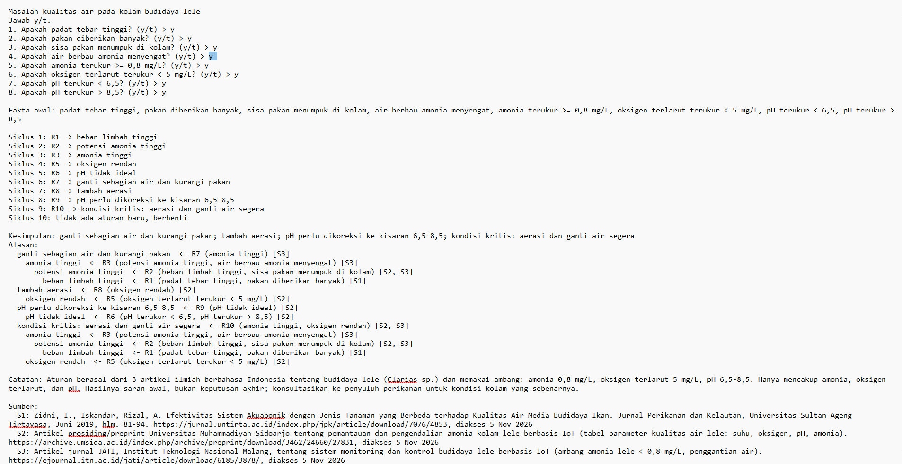
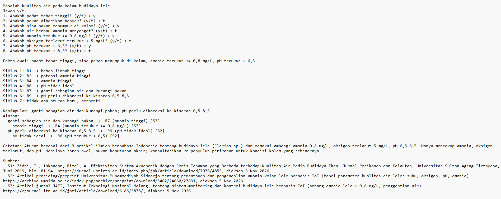
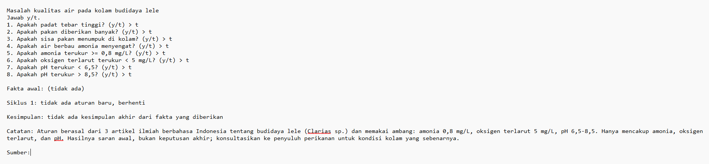

# Tugas 5 — Sistem Pakar Sederhana: Masalah Kualitas Air Kolam Lele

**Nama:** Rizky Fahrian Subban
**NIM:** F1D02510090

## 1. Topik dan cara menjalankan

Topik: diagnosis awal masalah kualitas air (amonia, oksigen terlarut, pH) pada kolam budidaya lele, beserta saran tindakannya.

- Bahasa: Python 3.12 (tanpa library tambahan)
- Mode interaktif (program bertanya y/t): `python sistem_pakar.py`
- Mode uji (tanpa bertanya, fakta dipisah titik koma): `python sistem_pakar.py --ya "padat tebar tinggi"`

File: `kb_lele.json` (basis aturan), `sistem_pakar.py` (mesin forward chaining).

## 2. Sumber dan aturan

| Kode | Sumber |
|------|--------|
| S1 | Zidni, Iskandar, Rizal. *Efektivitas Sistem Akuaponik dengan Jenis Tanaman yang Berbeda terhadap Kualitas Air Media Budidaya Ikan.* Jurnal Perikanan dan Kelautan, Untirta, Juni 2019. https://jurnal.untirta.ac.id/index.php/jpk/article/download/7076/4853 (diakses 5 Nov 2026) |
| S2 | Artikel Universitas Muhammadiyah Sidoarjo tentang pemantauan amonia kolam lele berbasis IoT (tabel parameter kualitas air lele). https://archive.umsida.ac.id/index.php/archive/preprint/download/3462/24660/27831 (diakses 5 Nov 2026) |
| S3 | Artikel JATI, Institut Teknologi Nasional Malang, tentang monitoring dan kontrol budidaya lele berbasis IoT. https://ejournal.itn.ac.id/jati/article/download/6185/3878/ (diakses 5 Nov 2026) |

| Aturan | IF | THEN | Sumber |
|--------|----|------|--------|
| R1 | padat tebar tinggi **OR** pakan diberikan banyak | beban limbah tinggi | S1 |
| R2 | beban limbah tinggi **OR** sisa pakan menumpuk di kolam | potensi amonia tinggi | S2, S3 |
| R3 | potensi amonia tinggi **AND** air berbau amonia menyengat | amonia tinggi | S3 |
| R4 | amonia terukur >= 0,8 mg/L | amonia tinggi | S3 |
| R5 | oksigen terlarut terukur < 5 mg/L | oksigen rendah | S2 |
| R6 | pH terukur < 6,5 **OR** pH terukur > 8,5 | pH tidak ideal | S2 |
| R7 | amonia tinggi | ganti sebagian air dan kurangi pakan | S3 |
| R8 | oksigen rendah | tambah aerasi | S2 |
| R9 | pH tidak ideal | pH perlu dikoreksi ke kisaran 6,5-8,5 | S2 |
| R10 | amonia tinggi **AND** oksigen rendah | kondisi kritis: aerasi dan ganti air segera | S2, S3 |

Rantai aturan (contoh): R1 → R2 → R3 → R7. Ada 4 kesimpulan akhir (R7, R8, R9, R10).

## 3. Metode: Forward Chaining

Dipilih karena data di lapangan berupa fakta pengamatan dan hasil ukur (padat tebar, bau air, kadar amonia, DO, pH), lalu kita ingin tahu apa yang bisa disimpulkan dari semuanya. Alur: mulai dari fakta yang dijawab "ya", jalankan aturan pertama yang syaratnya terpenuhi dan hasilnya belum ada di memori, tambahkan hasilnya ke memori, ulangi sampai tidak ada aturan baru. Kesimpulan akhir adalah fakta turunan yang tidak dipakai sebagai syarat aturan lain.

## 4. Kasus uji

| # | Jawaban "ya" | Kesimpulan |
|---|--------------|------------|
| 1 | padat tebar tinggi, sisa pakan menumpuk di kolam, air berbau amonia menyengat | ganti sebagian air dan kurangi pakan |
| 2 | amonia terukur >= 0,8 mg/L, oksigen terlarut terukur < 5 mg/L, pH terukur > 8,5 | ganti air + kurangi pakan; tambah aerasi; koreksi pH; kondisi kritis |
| 3 (negatif) | padat tebar tinggi saja | tidak ada kesimpulan akhir |

## 5. Batas keberlakuan

Pengetahuan dalam sistem ini diambil dari tiga artikel ilmiah berbahasa Indonesia tentang budidaya lele (Clarias sp.), dengan ambang amonia 0,8 mg/L, oksigen terlarut 5 mg/L, dan pH 6,5-8,5. Sistem hanya mencakup masalah amonia, oksigen terlarut, dan pH; suhu, penyakit, dan kualitas pakan tidak dicakup. Hasilnya berupa saran awal, bukan keputusan akhir, dan sebaiknya dikonfirmasi dengan pengukuran langsung dan penyuluh perikanan. Catatan ini juga ditampilkan oleh program.

## 6. Penggunaan alat bantu AI

Saya memakai Claude untuk membantu mencari sumber, menyusun draf aturan dan kerangka program. Saya sudah memeriksa sumber dan memahami kode serta aturannya.
